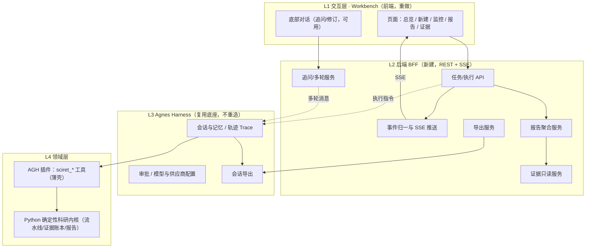

# paper-agent 2.0 需求文档总索引

> 项目：**paper-agent** —— 2026 江苏省 AI + 科学与工程创新实践黑客松参赛作品（队伍：你说的都队，编号 U046）
> 文档性质：**推翻重做（Rebuild）版本的需求基线**，可直接作为前后端开发、排期与验收依据。
> 立场说明：旧版 `paper-agent/` 的产品定位与业务目标作为背景参考；**本套文档不受旧实现思路、架构或遗留设计约束**。
> 版本：v2.0-draft ｜ 日期：2026-10-09

---

## 一、文档清单与阅读顺序

| 顺序  | 文档                       | 面向角色              | 内容                                            |
| --- | ------------------------ | ----------------- | --------------------------------------------- |
| 1   | [README.md](./README.md) | 全员                | 总索引、共享问题登记册、目标架构总览、MVP 总范围                    |
| 2   | [前端需求文档.md](./前端需求文档.md) | 前端 / 设计 / 测试      | 信息架构、页面与组件、MVP 功能与优先级、验收标准、迭代规划、可扩展前端架构       |
| 3   | [后端需求文档.md](./后端需求文档.md) | 后端 / 架构 / 测试 / 运维 | 领域模型、服务与 API、AGH 集成、MVP 功能与优先级、验收标准、部署启动、迭代规划 |

建议阅读顺序：**先读本 README 建立全局认知 → 前端读《前端需求文档》→ 后端读《后端需求文档》**。两份文档共用同一套问题编号（P-01 ~ P-07）与术语，可独立交付。

---

## 二、产品定位与业务目标（背景与共识）

### 2.1 一句话定位

**paper-agent 是一套"可审计、可复现、证据可溯源"的科研智能体工作台**：用户输入一个研究问题，系统基于 **Agnes Harness（AGH）执行底座**，驱动标准化科研流水线（多源检索 → 论文精读 → 创新点拆解 → 事实验证 → 综述写作 → 自评审），最终交付**一份结构化、结论可溯源、可导出复核的科研报告**。

### 2.2 核心价值主张

| 价值                    | 含义                                     |
| --------------------- | -------------------------------------- |
| **可审计（Auditable）**    | 每一步、每次工具调用、每个模型判断都被记录；报告结论强制绑定证据，可逐条复核 |
| **可复现（Reproducible）** | 确定性内核 + 冻结快照，相同输入可复现；实验产物以 SHA-256 校验  |
| **证据可溯源（Provenance）** | 每条结论可回溯到真实文献 DOI 或带哈希的产物文件，模型判断与事实分级管理 |
| **可交付（Deliverable）**  | 结果沉淀为一份完整报告，而非零散信息；支持报告 / 审计包 / 会话轨迹导出 |

### 2.3 目标用户

- **主要用户**：需要快速完成文献调研与综述、且要求结论可信、可溯源的科研工作者 / 学生 / 工程研究人员。
  
  | 次要关注方     | 关注点                    |
  | --------- | ---------------------- |
  | 评审 / 审计者  | 过程是否可追溯、证据是否真实、结论是否站得住 |
  | 演示 / 交付场景 | 3 分钟看懂主线、现场稳定可复现       |

### 2.4 业务成功标准（北极星与关键指标）

| 维度    | 指标（MVP 目标）                              |
| ----- | --------------------------------------- |
| 任务完成  | 用户新建任务后，能稳定跑完整条流水线并得到报告（正常路径成功率 ≥ 95%）  |
| 结果可交付 | 每次完成的任务都生成**一份完整报告**，且可导出（报告生成率 100%）   |
| 可信可溯源 | 报告中每条结论都绑定有效证据（绑定覆盖率 100%），证据可点击回查      |
| 记录可追溯 | 每次任务在 **AGH 中都有对应会话记录**并可导出（会话留痕率 100%） |
| 易用性   | 一条命令启动；3 分钟理解"新建 → 运行 → 报告 → 溯源 → 导出"主线 |
| 演示可靠  | 支持离线演示模式，断网可完整演示，现场零隐性依赖                |

---

## 三、共享问题登记册（旧版 7 个明显问题）

> 以下问题来自团队对旧版本的复盘。**每个问题都必须在新版中被逐一解决**；前后端文档中均设有"问题 → 处理方案"专章，此处为统一总表。

| 编号       | 问题（原话归纳）                                | 本质归因                                                  | 主要责任侧     |
| -------- | --------------------------------------- | ----------------------------------------------------- | --------- |
| **P-01** | 任务总是降级                                  | 单源不可用（OR 逻辑）即标记降级；无连通性预检；重试过于激进；"主动选离线"与"远程失败兜底"被混为一谈 | 后端为主，前端配合 |
| **P-02** | 前端展示了过多后端的东西，易读性不好、对用户不友好               | 把系统提示词、工具原始 JSON、哈希等内部对象直接堆给用户；缺少信息分层                 | 前端为主，后端配合 |
| **P-03** | 输出结果没有成为报告，是零散分布的；思考过程、工具调用及最终结果没有输出到前端 | 缺少统一的"报告"聚合产物；事件覆盖不全；最终结果未保证送达                        | 后端 + 前端   |
| **P-04** | 前端提问得到结果后，AGH 里没有任何记录，无法导出              | Web 后端**直接 spawn Python、完全绕过 AGH**，任务未进入 AGH 会话       | 后端为主，前端配合 |
| **P-05** | 底部对话框没起到任何作用                            | 追问 / 多轮能力未接线，只留下一个被禁用的输入框                             | 后端 + 前端   |
| **P-06** | 怀疑没有真正继承好 AGH                           | 未把 AGH 作为执行 + 记忆 + 导出底座，而是另起了一套并行外壳                   | 架构 / 后端   |
| **P-07** | 启动特别麻烦，不知道该怎么启动                         | 缺少单一入口、环境契约脆弱、隐性依赖多、无自检                               | 后端 / 运维   |

> 每个问题的**具体处理方案、落点模块与可复测的验收标准**，见《前端需求文档》第二章与《后端需求文档》第二章。

---

## 四、目标架构总览（共识）

### 4.1 核心架构原则

1. **AGH 是不可旁路的底座**：所有任务执行都经由 AGH 会话完成，天然获得会话记录、轨迹、审批与导出能力（解决 P-04 / P-06）。
2. **领域能力以 AGH 插件 / 工具形式交付**：科研流水线与证据 / 报告能力通过插件接入，保持可插拔。
3. **前后端分离、单向依赖**：前端 → 后端 BFF（REST + SSE）→ AGH（SDK / 会话）→ 领域内核；禁止反向依赖与跨层直连。
4. **报告是中心产物**：后端聚合统一报告模型，前端以报告为中心组织界面（解决 P-03）。
5. **分层披露、用户友好**：默认展示人类可读内容，技术 / 审计细节按需展开（解决 P-02）。
6. **确定性与可扩展性并重**：领域内核保持确定性可复现；工具、数据源、工作流、导出器均以 SPI / 插件方式扩展。

### 4.2 总体架构图

**关键数据流**：

- **执行流（写）**：前端操作 → BFF → **AGH 会话**（全程留痕）→ 插件工具 → Python 内核。
- **回流（读）**：内核产物 → 经 AGH 会话事件 + BFF 读取产物 → 归一为 SSE / 报告 DTO → 前端。
- **导出流**：报告 / 证据 / 会话轨迹统一由导出服务归集，会话轨迹来自 AGH 原生导出。

> 与旧架构的**根本区别**：旧版 BFF 直接 spawn Python（绕过 AGH，导致 P-04 / P-06）；新版 BFF **只通过 AGH 会话驱动执行**，因此每个任务都在 AGH 中留痕、可导出。

---

## 五、MVP 总范围（前后端汇总）

### 5.1 MVP 做什么（In Scope）

| 模块        | MVP 必备能力                                      |
| --------- | --------------------------------------------- |
| 启动 / 运维   | **一条命令启动**前后端 + AGH；环境自检 `doctor`，错误给人类可读修复指引 |
| 任务管理      | 新建任务（目标 + 工作流 + 数据源）、任务列表、任务详情                |
| 执行（经 AGH） | 跑完整流程 / 单步推进 / 停止 / 断点续跑；**全部在 AGH 会话中留痕**    |
| 实时反馈      | SSE 推送步骤、工具、降级、结论、消息、完成事件；有序、可去重、断线可补         |
| 报告（中心）    | 聚合生成**一份结构化报告**（含结论与证据链接），完成后必达、刷新可看          |
| 证据溯源      | 只读证据列表 / 轨迹 / 引用回查，结论 ↔ 证据可点击跳转               |
| 导出        | 导出报告 Markdown、审计包、AGH 会话轨迹                    |
| 追问 / 多轮   | **底部对话框真正可用**：对报告追问、请求修订；运行中排队                |
| 降级治理      | 重定义降级分类与覆盖策略、统一重试与超时、连通性预检；故障注入默认关闭           |
| 演示模式      | 前端 Mock / 离线模式，断网可完整演示                        |

### 5.2 MVP 明确不做（Out of Scope）

- 多用户 / 登录鉴权 / 云端部署（MVP 为单机本地、绑定回环地址）。
- 论文全文批量抓取（合规红线）。
- 用 LLM 自由编排取代确定性状态机（违背可复现承诺；仅在受控边界内引入模型判断）。
- 跨 run 证据图谱 / 高级检索与聚合（列为 MVP 后迭代）。
- 移动端原生 App、实时多人协作、插件市场等。

### 5.3 MVP 之后（详见各文档迭代章节）

- **V1.x**：证据查询层（SQLite 索引、跨 run 检索、证据图谱）、设置与模板、可选鉴权、更多数据源 / MCP。
- **V2.0**：多用户 / 云部署、批量与定时任务、通知、可观测性增强、工作流 / 插件市场、协作与批注。

---

## 六、验收总原则（Definition of Done）

一个功能可被标记为"完成"，须同时满足：

1. **需求覆盖**：对应功能在文档中的描述与验收标准全部达成。
2. **问题复测**：相关问题（P-01 ~ P-07）可被重新测试且通过（不复发）。
3. **真实链路**：在真实 AGH 环境下验证（非仅 Mock），任务在 AGH 会话中留痕、可导出。
4. **质量门**：代码通过 Lint / 类型检查 / 构建；新增测试通过；关键路径有自动化测试。
5. **可演示**：主旅程（新建 → 运行 → 报告 → 溯源 → 导出）可稳定走通；离线模式可演示。
6. **文档一致**：实现与文档一致，术语 / 字段 / 枚举单一真源，无自相矛盾。

---

## 附录：术语表（统一）

| 术语                | 含义                                                      |
| ----------------- | ------------------------------------------------------- |
| **AGH**           | Agnes Harness，智能体执行底座（运行时、会话、记忆、审批、导出）                  |
| **Task / Run**    | 一次科研任务实例（旧版称 run，`run-YYYYMMDD-HHMMSS-xxxxxx`）          |
| **Session**       | AGH 会话；新版中**一个 Task 对应一个 AGH Session**                  |
| **Workflow**      | 工作流，决定步骤集合（默认 `research` 六步 R1~R6；`materials` 五步 P1~P5） |
| **Step**          | 工作流中的单个步骤                                               |
| **Evidence（EV）**  | 证据条目，含 tier / kind / 引用 / SHA-256 / 生产步骤                |
| **Conclusion（C）** | 结论，强制绑定 fact 级证据                                        |
| **Report**        | 最终聚合的科研报告（中心交付物）                                        |
| **Audit Pack**    | 审计交付包（报告 + 账本 + 事件 + 校验脚本等）                             |
| **BFF**           | 面向前端的后端网关（Backend for Frontend）                         |
| **SPI**           | 服务提供者接口（工具 / 数据源 / 工作流 / 导出器等扩展点）                       |
