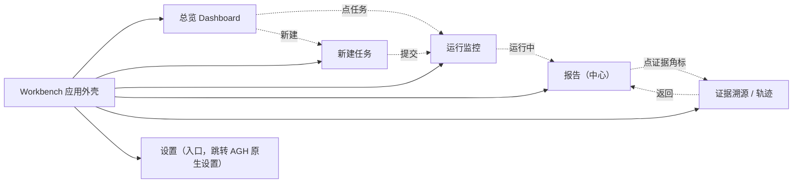
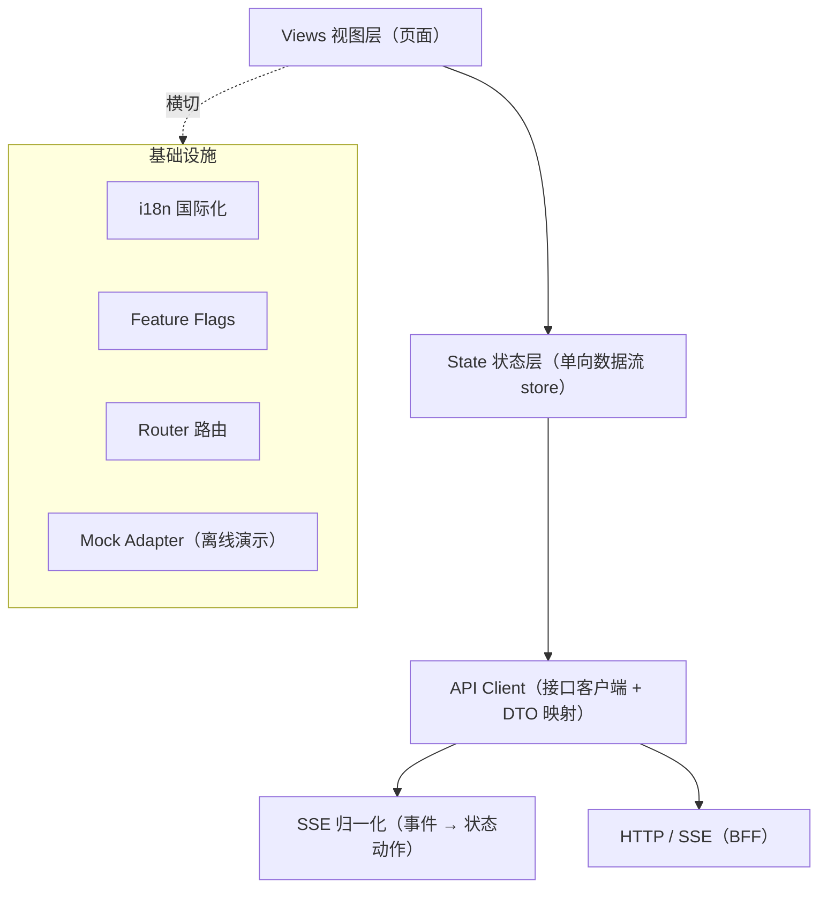
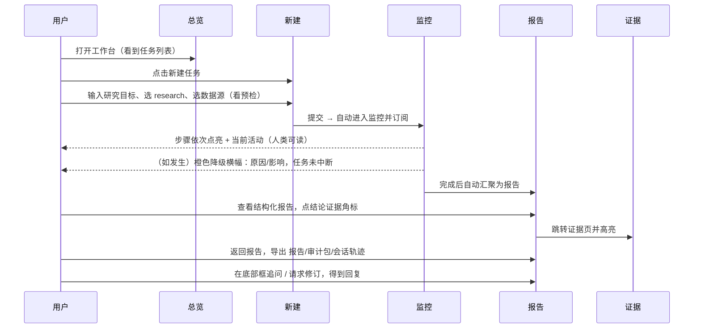

# paper-agent 2.0 前端需求文档（科研工作台 Workbench）

> 项目：paper-agent ｜ 队伍：你说的都队（U046）
> 文档类型：**前端需求规格说明书（Rebuild 版）**，可直接作为前端开发、设计、测试与排期依据。
> 版本：v2.0-draft ｜ 日期：2026-10-09 ｜ 状态：待评审
> 配套文档：《[后端需求文档.md](./后端需求文档.md)》《[README.md](./README.md)》

---

## 1. 文档信息与范围界定

### 1.1 前端使命

构建一个**以"科研报告"为中心、用户友好、过程可信、现场可靠**的科研工作台。用户只需"提出问题 → 观察进展 → 获得报告 → 溯源证据 → 导出交付"，无需理解任何后端内部概念。

### 1.2 范围界定（MVP）

| 类别 | 范围 |
|---|---|
| **In Scope（做）** | 应用外壳与导航、总览、新建任务向导、运行监控、报告视图、证据溯源（只读）、导出交互、可用的底部追问框、全局状态反馈、Mock/离线演示模式、设计系统与响应式 |
| **Out of Scope（不做）** | 模型/供应商深度配置（复用 AGH 原生设置，仅做入口跳转）、跨 run 证据图谱与高级检索、多用户/鉴权、移动端原生 App、实时多人协作、富文本批注编辑 |
| **技术红线变更** | 旧版"前端零第三方依赖、零构建"红线**在工作台层废止**（该红线仅服务于 Python 可复现内核）。新版采用现代前端工程栈以获得类型、组件生态与自动化测试 |

### 1.3 术语

沿用《README.md》附录术语表：AGH、Task/Run、Session、Workflow、Step、Evidence(EV)、Conclusion(C)、Report、Audit Pack、BFF、SPI。

---

## 2. 已知问题与前端处理方案（逐条，必须解决）

> 对应《README.md》共享问题登记册 P-01 ~ P-07。下表给出**前端侧的具体处理方案与落点**；后端配套方案见后端文档第 2 章。

### 2.1 问题 → 前端方案总表

| 编号 | 问题 | 前端处理方案 | 落点 |
|---|---|---|---|
| **P-01** | 任务总是降级 | ① 新建向导显示数据源连通性预检结果，不可用源不默认勾选；② 区分**灰色"部分源不可用（覆盖充足）"提示**与**橙色"已降级（任务未中断）"横幅**，降级一律橙色、附原因与影响、提供"重试/改源"动作；③ 主动选择离线/本地模式时不显示降级 | 新建向导、监控页、状态组件 |
| **P-02** | 前端暴露过多后端内容、不友好 | ① **信息分层 / 渐进披露**：默认只显示人类可读内容；系统提示词、工具原始入参出参、哈希链等收入"过程 / 审计细节"折叠区（或独立"审计"视图）；② 用领域语言替换原始字段名；③ 统一设计系统与组件，杜绝直接渲染原始 JSON | 全站信息架构、设计系统 |
| **P-03** | 输出未形成报告、零散；最终结果未送达前端 | ① 设立**报告中心视图**，把各步骤结果聚合为结构化报告（背景/方法/发现/结论，结论带证据链接）；② 运行中显示进度，完成后自动汇聚为报告并展示；③ "最终报告"区域始终存在，刷新/重连后仍可从后端重取；④ 思考/工具过程移至可折叠的次要区域 | 报告视图、监控视图 |
| **P-04** | AGH 中无记录、无法导出 | ① 展示任务对应的 **AGH 会话标识与"已记录"状态**；② 提供导出入口（报告 Markdown / 审计包 / 会话轨迹），导出结果明确反馈成功/失败；③ 历史列表可重新打开已记录的任务 | 报告页导出区、总览、任务详情 |
| **P-05** | 底部对话框不起作用 | **MVP 让其真正可用**：支持对报告追问、请求修订（多轮）；运行中消息进入排队并显示顺序；支持发送/快捷键/禁用态/失败重试。若某场景不支持多轮，则**移除**该输入框而非展示禁用框（默认主流程必须可用） | 底部 Composer 组件 |
| **P-06** | 未真正继承 AGH | 前端统一消费 BFF 的会话化数据（其背后为 AGH 会话）；复用会话事件模型与轨迹；用户每一次操作都对应会话记录；"审计/轨迹"视图呈现 AGH 记录，不另造并行体系 | 数据流、轨迹视图 |
| **P-07** | 启动麻烦、不会启动 | 前端由启动器统一托管（无需手动起静态服务器）；首屏提供引导与环境健康状态；配置缺失时在界面给出可读指引与跳转 | 启动器对接、首屏引导、健康状态 |

### 2.2 关键交互铁律（不可违反）

1. **状态色语义统一**：🟢 已完成 ｜ 🔵 运行中 ｜ 🟠 已降级（**任务未中断，绝不用红色**）｜ 🔴 失败 ｜ ⚪ 待执行。
2. **不出现"假控件"**：任何可见可交互元素必须真实可用；不可用则禁用并说明原因或直接隐藏。
3. **不直接向用户展示原始 JSON / 系统提示词 / 哈希**，除非用户主动展开"技术 / 审计细节"。
4. **最终报告必须可达**：任务完成后，无论刷新、重连，用户都能看到同一份报告。
5. **每个错误态都有人类可读的说明与下一步动作**，不出现技术性堆栈弹窗。

---

## 3. 设计原则

| 原则 | 说明 |
|---|---|
| **报告中心（Report-first）** | 界面围绕"产出一份报告"组织，监控与证据都是报告的支撑视图 |
| **渐进披露（Progressive Disclosure）** | 先结论与摘要，细节按需展开；普通用户与审计者各取所需 |
| **用户语言（User Language）** | 使用科研人员熟悉的概念，屏蔽工具名/状态机/哈希等实现细节 |
| **一致性（Consistency）** | 设计令牌、组件、状态色、文案、间距全局统一 |
| **即时反馈（Feedback）** | 每个操作有加载、成功、失败、排队等明确反馈；长任务有进度 |
| **可靠演示（Reliable Demo）** | 内置 Mock/离线模式，断网可完整、可重复地演示 |
| **可访问 & 响应式（A11y / RWD）** | 达 WCAG AA，键盘可达；主流分辨率与笔记本屏可用 |

---

## 4. 信息架构与导航

### 4.1 站点地图（Sitemap）



### 4.2 全局导航结构

- **左侧持久导航栏**（宽 220px，可折叠为 64px 图标栏）：
  顺序 **总览 / 新建任务 / 运行监控 / 报告 / 证据溯源 / 设置**；图标 + 中文标签 + 选中态强调色；`aria-current`。
- **顶部上下文栏**（高 56px）：当前页面标题 ｜ 当前任务标识（可复制）｜ 状态徽章 ｜ 右侧全局动作（新建、导出）。
- **主内容区**：按路由切换页面。
- **底部 Composer**：在监控 / 报告页常驻的追问 / 修订输入区（详见 §8.8）。

### 4.3 路由表

| 路由 | 页面 | 说明 | MVP |
|---|---|---|---|
| `/` 或 `/overview` | 总览 | 任务列表 + 状态 + 快速新建 | P0 |
| `/new` | 新建任务 | 向导式创建 | P0 |
| `/monitor/:taskId` | 运行监控 | 实时步骤与活动 | P0 |
| `/report/:taskId` | 报告 | 结构化报告（中心页） | P0 |
| `/evidence/:taskId` | 证据溯源 | 证据/轨迹只读，支持 EV 高亮 | P0 |
| `/settings` | 设置 | 占位 + 跳转 AGH 原生设置 | P2 |
| 路由参数 `?ev=EV-0001` | — | 进入证据页并高亮指定证据 | P0 |

> 未命中路由 → 友好的 404 空状态，提供"返回总览 / 新建任务"动作。

---

## 5. 设计系统（Design System）

### 5.1 设计令牌（Tokens，唯一真源）

| Token | 值（建议，可在设计评审微调） | 用途 |
|---|---|---|
| `--bg` | `#0B0B0C` | 页面底色 |
| `--surface` | `#141416` | 卡片底色 |
| `--surface-2` | `#1A1A1D` | 悬停 / 选中面 |
| `--raised` | `#202024` | 图标 / 标签底 |
| `--ink` | `#E8E8E6` | 主正文 |
| `--ink-3` | `#8A8A85` | 弱化标签 |
| `--accent` | `#D9A441`（琥珀，唯一强调色） | 选中、主操作、进度高亮 |
| `--ok / --run / --warn / --fail` | `#6BBF8A / #7FA8D9 / #D98A5A / #E5646A` | 状态色（低饱和，仅用于点/字/描边） |
| 间距 `--s1..--s8` | 4 / 8 / 12 / 16 / 24 / 32 / 48 / 64 px | 所有间距为 4 的倍数 |
| 圆角 `--r / --r-sm / --r-pill` | 10 / 6 / 20 px | 卡片 / 控件 / 胶囊 |
| 字体 | 正文 Inter / 系统无衬线；数据与代码用等宽 | 排版 |
| 动效 | `cubic-bezier(.4,0,.2,1)`，150ms | 状态切换、进度微光 |

> 令牌以 CSS Variables / TS 常量双份同源管理；**禁止在组件中硬编码颜色 / 间距 / 圆角**。
> 浅色主题为 MVP 后迭代，但令牌结构需为多主题预留（用变量而非固定值）。

### 5.2 组件库（Component Inventory）

| 类别 | 组件 |
|---|---|
| 基础 | Button（solid / ghost / chip）、Icon、Tag / Badge、Avatar、Divider、Spinner / Progress |
| 容器 | Card、Panel、Collapse / Accordion、Tabs、Tooltip / Popover、Modal / Drawer |
| 业务 | **StepBar（步骤条）**、**ActivityCard（活动卡，人类可读）**、**DegradedBanner（降级横幅）**、**ReportView（报告渲染）**、**EvidenceCard（证据卡）**、ConclusionItem（结论项）、SourceStatus（数据源状态）、VerdictCard（核验结论） |
| 输入 | Composer（底部追问框）、Textarea、TextInput、Select、Checkbox / Switch、SourcePicker（数据源选择） |
| 数据 | DataTable、List、EmptyState、Skeleton、Toast / Notification、Breadcrumb |

### 5.3 状态徽章语义（全局统一）

| 状态 | 颜色 | 文案语义 |
|---|---|---|
| 已完成 | 🟢 `--ok` | 任务 / 步骤已完成 |
| 运行中 | 🔵 `--run` | 正在执行，可显示当前活动与进度 |
| 已降级 | 🟠 `--warn` | **自动调整（如切源/跳过），任务未中断**；附原因与影响 |
| 失败 | 🔴 `--fail` | 未能完成，附原因与"重试 / 修改后重跑"动作 |
| 待执行 | ⚪ 中性 | 尚未开始 |
| 部分源不可用（信息提示） | 灰 / 中性描边 | 覆盖充足，不影响结果（区别于"已降级"） |

---

## 6. 前端架构与数据流

### 6.1 分层架构



### 6.2 单向数据流

- **唯一数据流向**：`API（HTTP/SSE）→ Store → Views`；视图不直接改服务端数据，只触发 action。
- **SSE 归一化**：后端事件统一在 API Client / Store 层映射为前端状态动作（`step / activity / degraded / conclusion / message / done`），视图只消费归一化后的模型；**实时路径与刷新后路径使用同一数据形状**（旧版"实时与刷新不一致"缺陷由此消除）。
- **去重与顺序**：按步骤 / 活动 / 结论的稳定 ID 去重；事件按序号 / 时间戳保证顺序。
- **断线重连与补数**：重连后先拉任务快照，再续接事件；支持 Last-Event-ID / 快照兜底（与后端约定，见后端文档 §5）。

### 6.3 Mock / Live 双模式

| 模式 | 数据来源 | 用途 |
|---|---|---|
| **Mock（默认演示）** | 本地固定数据 + 模拟推进器（按真实节奏定时推进） | 断网演示、UI 开发、现场零依赖 |
| **Live（联调 / 真实）** | BFF（背后为真实 AGH 会话） | 真实跑任务、加分演示、验收 |

- 模式由环境变量 / 启动参数 / URL 参数统一决定；**切换模式不改视图代码**（API Client 内部适配）。
- Mock 数据字段结构必须与后端 DTO 保持一致（由共享契约 / 类型约束），禁止自创字段。

### 6.4 推荐目录结构

```
web/
├── index.html
├── public/
├── src/
│   ├── app/                 # 应用装配、路由、Provider
│   ├── pages/               # 页面：overview / new / monitor / report / evidence / settings
│   ├── components/          # 通用组件 + 业务组件
│   ├── features/            # 按业务域聚合（tasks / report / evidence / composer）
│   ├── store/               # 状态管理、切片、动作
│   ├── api/                 # HTTP/SSE 客户端、DTO、SSE 归一、mock adapter
│   ├── styles/              # tokens、全局样式、组件样式
│   ├── i18n/                # 语言资源（zh 优先，预留 en）
│   ├── config/              # 环境配置、feature flags
│   └── lib/                 # 通用工具
├── tests/                   # 单元 / 组件 / E2E
└── package.json
```

---

## 7. MVP 功能范围与优先级

### 7.1 优先级定义

| 级别 | 含义 |
|---|---|
| **P0（Must）** | MVP 必须交付，缺失则主线 / 演示不成立 |
| **P1（Should）** | MVP 应交付，显著提升体验与可信度 |
| **P2（Could）** | 可在 MVP 末或之后交付 |

### 7.2 MVP 功能清单

| 编号 | 功能 | 所属页面 | 优先级 | 对应问题 |
|---|---|---|---|---|
| FE-01 | 应用外壳、左侧导航、顶部上下文栏、路由 | 全局 | P0 | P-02、P-07 |
| FE-02 | 设计令牌与基础组件库落地 | 全局 | P0 | P-02 |
| FE-03 | 总览：任务列表（状态/时间）、快速新建、简单统计 | 总览 | P0 | P-04 |
| FE-04 | 新建任务向导：目标输入、工作流选择、数据源选择、连通性预检、提交 | 新建 | P0 | P-01、P-04 |
| FE-05 | 运行监控：人类可读步骤进度、当前活动、SSE 实时更新 | 监控 | P0 | P-03、P-06 |
| FE-06 | 降级 / 部分源不可用提示（分级、橙色、原因与影响、重试/改源） | 监控 | P0 | P-01 |
| FE-07 | **报告中心视图**：结构化报告、结论带证据链接、完成必达、刷新可看 | 报告 | P0 | P-03 |
| FE-08 | 证据溯源（只读）：证据/轨迹列表、结论↔证据跳转、EV 高亮 | 证据 | P0 | P-02、P-06 |
| FE-09 | 导出交互：报告 MD / 审计包 / 会话轨迹，结果反馈 | 报告 | P0 | P-04 |
| FE-10 | **底部 Composer 可用**：追问 / 请求修订、运行中排队、发送/快捷键/重试 | 监控/报告 | P0 | P-05 |
| FE-11 | 全局状态反馈：加载骨架、空状态、错误（含下一步）、Toast | 全局 | P0 | P-02 |
| FE-12 | Mock / 离线演示模式 | 全局 | P0 | P-07 |
| FE-13 | 响应式布局（笔记本/常见分辨率）、基础无障碍 | 全局 | P1 | — |
| FE-14 | 环境健康状态首屏提示（与 doctor 对接） | 全局 | P1 | P-07 |
| FE-15 | 设置占位与跳转 AGH 原生设置 | 设置 | P2 | — |

---

## 8. 页面与功能详细需求（含验收标准）

> 验收采用 Given/When/Then 表达；每个 P0 功能至少包含主路径与关键异常路径。

### 8.1 FE-01/02 应用外壳与设计系统（P0）

- **需求**：左侧可折叠导航 + 顶部上下文栏 + 主内容区 + 路由；全局令牌与基础组件统一。
- **验收标准**：
  - Given 用户打开应用，When 首屏加载完成，Then 可见导航、上下文栏与默认总览页，无布局错位。
  - When 点击各导航项，Then 在对应路由间切换，选中态高亮且 `aria-current` 正确。
  - Then 全站颜色/间距/圆角/字体均来自令牌，无硬编码。
  - When 导航折叠为图标栏，Then 图标可见、可点击、有 tooltip。

### 8.2 FE-03 总览 Dashboard（P0）

- **需求**：展示任务列表（状态徽章、目标摘要、相对时间）、"新建任务"主按钮、简单统计（任务数、完成数等）。
- **验收标准**：
  - Given 存在多个任务（含运行中/已降级/失败/完成），When 进入总览，Then 列表按时间倒序展示且状态徽章语义正确。
  - When 点击某任务，Then 运行中→监控页、已完成→报告页。
  - When 点击"新建任务"，Then 进入新建向导。
  - Given 无任何任务，When 进入总览，Then 显示 EmptyState 并引导新建。

### 8.3 FE-04 新建任务向导（P0）

- **需求**：三段式——①研究目标（大文本框，含示例占位）；②工作流卡片（默认 research，显示步骤链）；③数据源选择（含连通性预检，不可用项标注/不默认选）；提交后进入监控并自动订阅。
- **验收标准**：
  - When 用户输入目标、切换工作流/数据源，Then 摘要与"将会发生什么"同步更新。
  - Given 数据源预检完成，When 某源不可用，Then 该项明确标注且不默认勾选，并说明影响。
  - When 目标为空提交，Then 行内提示（不弹窗），不创建任务。
  - When 合法提交，Then 创建任务并跳转监控页、自动接收实时进度。
  - When 提交失败，Then 显示可读错误与"重试"动作，已填内容保留。

### 8.4 FE-05 运行监控（P0）

- **需求**：以**人类可读方式**展示步骤进度（StepBar）与"系统当前正在做什么"（活动卡），经 SSE 实时更新；技术/工具细节置于"过程细节"折叠区。
- **验收标准**：
  - Given 任务运行中，When 收到步骤事件，Then StepBar 对应步骤由待执行→运行中（强调色）→完成（绿）。
  - Then 主区域显示当前活动的人类可读描述（如"正在检索相关文献…"），而非工具名/原始 JSON。
  - When 展开"过程细节"，Then 才可见工具调用及其入参/出参（只读、格式化）。
  - When 刷新页面，Then 通过快照 + 事件恢复到与实际一致的进度（与实时路径同形）。
  - When 断线，Then 显示断开提示与"重连/刷新"动作，重连后状态正确。

### 8.5 FE-06 降级与部分源不可用提示（P0）

- **需求**：区分两级——**信息级**（部分源不可用但覆盖充足，中性灰提示）与**降级级**（计划路径被改变，橙色横幅"任务未中断"，说明原因、影响范围，提供重试/改源）。
- **验收标准**：
  - Given 仅个别源不可用且结果覆盖充足，When 步骤完成，Then 显示中性"部分源不可用"提示，**不**标记整体降级。
  - Given 发生真实降级（如切源/跳过/兜底），When 触发，Then 显示**橙色**横幅，文案含"任务未中断"、具体原因与对结果的影响，绝不使用红色。
  - When 点击"这是什么/了解影响"，Then 展示通俗解释；When 点击"重试/改源"，Then 触发对应动作。
  - Given 用户主动选择本地/离线模式，When 运行，Then 不出现任何降级提示。

### 8.6 FE-07 报告中心视图（P0，核心）

- **需求**：把流水线结果聚合为**一份结构化报告**（标题/摘要、研究背景、方法与过程、核心发现、结论），每条结论内嵌可点击的证据角标；运行中显示"报告生成中"，完成后自动呈现；刷新/重连后可重新获取同一份报告。
- **验收标准**：
  - Given 任务完成，When 进入报告页，Then 看到完整结构化报告，而非零散卡片。
  - Then 每条结论都带证据角标（如 `[EV-0001]`），点击跳转证据页并高亮。
  - Given 任务尚在运行，When 打开报告页，Then 显示进度/生成中态；完成后自动更新为报告。
  - When 刷新或重连后重开报告，Then 报告内容一致、完整可达。
  - Given 报告尚未生成，When 提前进入，Then 明确提示"需先完成相应步骤"，而非报错堆栈。

### 8.7 FE-08 证据溯源 / 轨迹（P0，只读）

- **需求**：展示证据条目与过程轨迹（人类可读为主），支持结论 ↔ 证据绑定查看、按 EV 定位高亮；原始哈希/链信息收入"审计细节"。
- **验收标准**：
  - When 从报告点击证据角标，Then 跳转证据页、平滑滚动并高亮对应证据。
  - Then 证据以领域信息呈现（来源/标题/类型/生产步骤），哈希等在"审计细节"中按需查看。
  - Then 每条结论可查看其绑定的证据，绑定关系清晰。
  - When 数据缺失，Then 显示 EmptyState 而非空白或报错。
  - （基础筛选 fact/全部、关键词搜索可列 P1/P2，MVP 至少支持只读浏览与定位）。

### 8.8 FE-10 底部 Composer（追问 / 修订）（P0）

- **需求**：在监控/报告页常驻可用的输入区，支持**对报告追问、请求修订（多轮对话）**；运行中发送进入排队（显示顺序，可"立即发送/删除"）；支持发送按钮、Cmd/Ctrl+Enter、自动增高、失败重试、附件入口（附件可列 P1）。
- **验收标准**：
  - Given 报告已生成，When 输入追问并发送，Then 在同一会话中得到回复，报告/回答区域更新。
  - Given 任务运行中，When 发送消息，Then 消息进入排队并显示顺序，当前任务结束后按序执行。
  - When 排队中点击"立即发送"，Then 暂停当前并优先执行该条；点击"删除"，Then 仅移除该排队消息。
  - Then 支持 Cmd/Ctrl+Enter 发送；发送过程中输入区有明确状态，失败可重试且内容保留。
  - **不出现被禁用、无响应的"假"输入框**；若某页面确不支持多轮则不显示该 Composer。

### 8.9 FE-09 导出（P0）

- **需求**：在报告页提供导出面板——导出报告 Markdown、审计包（ZIP）、AGH 会话轨迹；显示导出内容清单与校验状态；导出过程有加载、成功/失败反馈。
- **验收标准**：
  - When 点击各导出项，Then 触发对应下载/生成，成功后明确提示，失败给原因与重试。
  - Then 展示导出包内容清单（报告/账本/事件/会话轨迹/校验脚本）及校验状态。
  - Given 任务未完成，When 尝试导出，Then 明确说明可导出范围或禁用并解释。

### 8.10 FE-11/12/13/14 全局反馈、演示模式、响应式与健康（P0/P1）

- **全局状态反馈（P0）**：加载用 Skeleton；空数据用 EmptyState（含引导动作）；错误用人类可读文案 + 下一步；操作结果用 Toast。
  - 验收：任一异步操作都有加载/成功/失败三态；无数据时不空白；错误不暴露原始堆栈。
- **Mock/离线模式（P0）**：默认 Mock，断网可完整走通主旅程；模拟推进按真实节奏。
  - 验收：断网状态下 新建→监控→报告→证据→导出 全程可演示、无报错。
- **响应式与无障碍（P1）**：1280px 及以上与常见笔记本分辨率良好布局；键盘可达、对比度达 AA。
  - 验收：纯键盘可完成主旅程；关键文字/背景对比度达标。
- **环境健康首屏（P1）**：与后端 doctor 对接，环境异常时首屏给出可读指引。
  - 验收：环境缺项时显示具体问题与修复/跳转，不出现误导性技术错误。

---

## 9. 核心用户旅程（演示主线）

### 9.1 旅程 A（推荐现场演示，约 3 分钟）



### 9.2 旅程 B（追问 / 修订）

报告页输入"请补充 XX 方向的最新进展"或"把结论部分改写得更简洁" → 同一会话多轮处理 → 报告 / 回答更新，全程在 AGH 会话留痕。

---

## 10. 非功能性需求（前端）

| 类别 | 要求 |
|---|---|
| 性能 | 首屏可交互时间 ≤ 3s（本地）；路由切换 ≤ 300ms；SSE 事件到 UI 更新无明显延迟；长列表虚拟滚动/分页 |
| 兼容 | 主流 Chromium / Edge / Firefox 近两个大版本；推荐分辨率 1366×768 及以上，1920×1080 良好 |
| 响应式 | 1280–1920px 区间无横向溢出、无重叠；导航可折叠 |
| 可访问 | WCAG AA：对比度、键盘操作、焦点可见、语义化标签、`aria-*` 完备 |
| 国际化 | 简体中文优先；文案外置（i18n），结构上预留英文；自动标题语言规则与 AGH 对齐 |
| 可测试 | 组件/状态/工具函数有单测；关键流程有 E2E；Mock 数据可复用 |
| 可维护 | TypeScript 严格模式；ESLint/Prettier；组件单一职责；令牌与类型共享 |
| 安全 | 渲染报告/Markdown 需消毒（防 XSS）；不渲染不可信 HTML；不存储/回显密钥明文 |

---

## 11. MVP 之后迭代规划

### 11.1 迭代路线图

| 阶段 | 主题 | 主要内容 |
|---|---|---|
| **MVP（V1.0）** | 跑通主线、报告中心、稳定演示 | 见 §7 全部 P0 |
| **V1.1** | 可信度与体验增强 | 证据筛选/关键词搜索、证据分页、浅色主题、引导式 Onboarding、通知中心、报告目录与历史归档 |
| **V1.2** | 证据能力升级（对接后端查询层） | 跨 run 证据检索、证据关系图谱、结论-证据-文献可视化、引用一键复制（APA/IEEE/BibTeX）、报告对比/版本 Diff |
| **V1.3** | 个性化与模板 | 报告模板库、自定义章节、默认工作流/数据源偏好、可选 token 鉴权、更多数据源与 MCP 入口 |
| **V2.0** | 平台化 / 协作 | 多用户与权限、云部署、批量与定时任务、实时协作与批注、可观测性看板、工作流/插件市场、PWA/移动端适配 |

### 11.2 功能演进方向（按域）

| 域 | MVP 后方向 |
|---|---|
| 报告 | 模板与自定义章节、多格式导出（PDF/DOCX/HTML）、版本对比、在线批注、引用格式切换 |
| 证据 | 高级筛选、跨 run 检索、证据图谱、证据可信度标注、证据聚合统计 |
| 交互 | 多模态附件（PDF/图片/表格）、语音输入、富文本追问、建议问题（Prompt 建议） |
| 个性化 | 主题切换、语言切换、偏好设置、仪表盘自定义 |
| 协作 | 分享链接、评论、多人会话、任务分派（依赖后端鉴权） |
| 工程 | 微前端 / 扩展插槽（对齐 AGH slots）、组件文档站、可视化回归测试、灰度与 Feature 管理 |

---

## 12. 可扩展性设计（前端）

| 扩展场景 | 设计保障 |
|---|---|
| **新增页面** | 路由 + 页面模块 + 导航项配置化；页面只依赖共享 store / api，不耦合其他页面 |
| **新增组件** | 组件库分层（基础/业务），通过组合复用；业务组件以数据驱动（props/类型） |
| **接入新数据源 / 工作流** | 由配置与常量驱动（数据源、步骤链、标签均为数据），新增不改核心渲染 |
| **新增主题 / 语言** | 令牌变量化 + i18n 资源外置，新增主题/语言为增量配置 |
| **对接后端新事件** | SSE 归一层集中映射事件 → 动作；视图不直接绑定原始事件 |
| **嵌入 / 被嵌入** | 预留对齐 AGH UI slots（tool.card.inline / sidebar.action / status.line / notification）的适配层；未来可微前端化 |
| **Mock 与真实切换** | API Client 适配器模式，双模式同形，便于离线开发与演示 |

---

## 13. 技术栈与工程规范（建议）

### 13.1 推荐技术栈

| 层 | 选型 | 理由 |
|---|---|---|
| 构建 | **Vite** | 快速、零配置、生态成熟 |
| 框架 | **React 18 + TypeScript（strict）** | 组件生态、类型安全、可测试 |
| 路由 | React Router | 标准路由方案 |
| 数据/状态 | TanStack Query（服务端状态）+ Zustand/Context（UI 状态） | 缓存、重试、SSE 协同；轻量状态 |
| 样式 | 令牌 + CSS Modules / 轻量 CSS-in-JS | 设计系统落地、避免样式冲突 |
| Markdown/报告 | `react-markdown` + `remark-gfm` + 消毒（`rehype-sanitize`） | 安全渲染报告 |
| 国际化 | i18next | 多语言预留 |
| 测试 | Vitest + Testing Library + Playwright | 单元/组件/E2E |
| 质量 | ESLint + Prettier + TypeScript + Husky/lint-staged | 代码质量门 |

> 组件库可按需选择成熟无头组件（Headless UI / Radix 类）以保证可访问性，视觉仍以自有令牌为准。

### 13.2 工程规范要点

- 命名：组件 PascalCase、文件与函数语义化；常量与枚举集中管理。
- 目录按 §6.4；页面（pages）与业务特性（features）分离。
- 所有接口经 API Client，禁止视图内裸 fetch；所有颜色/间距走令牌。
- 提交前跑类型检查 + Lint + 相关测试；CI 构建并跑测试。
- 前后端 DTO / 事件以共享类型 / OpenAPI 契约约束，防止字段漂移。

---

## 14. 前端验收总清单（DoD）

- [ ] §7 中所有 **P0 功能**实现并通过 §8 验收标准。
- [ ] **问题复测**：P-01 ~ P-07 在前端侧可复测且通过（不复发）。
- [ ] 主旅程（新建→监控→报告→证据→导出→追问）在 **Live 真实 AGH 环境**走通。
- [ ] **Mock 模式断网**可完整、可重复演示。
- [ ] 任务对应的 **AGH 会话可记录、可导出**；导出三选项（报告/审计包/会话轨迹）可用。
- [ ] 报告为**一份完整结构化报告**，结论证据绑定 100%，刷新/重连一致。
- [ ] 无"假控件"、无直接展示的原始 JSON/系统提示词/哈希（除主动展开的审计细节）。
- [ ] 降级一律橙色 + "任务未中断" + 原因影响；主动离线不判降级。
- [ ] 通过类型检查 / Lint / 构建；关键路径有自动化测试。
- [ ] 达响应式与基础无障碍要求；术语/字段与后端文档一致。

---

## 附录 A：前端消费的核心 DTO（摘要，详细契约以后端文档为准）

| DTO | 关键字段 | 来源 |
|---|---|---|
| 任务快照 TaskSnapshot | `task_id / title(goal) / workflow / run_status / steps[] / degraded / session_id / created_at` | `GET /api/tasks/{id}` |
| 步骤 Step | `id / label / status / attempts / is_current` | 快照 + SSE `step` |
| 活动 Activity | `step / human_message / detail? / ts` | SSE `activity` |
| 降级 DegradedInfo | `level(info/degraded) / source / reason / impact / resumable` | SSE `degraded` |
| 报告 Report | `title / abstract / sections[] / conclusions[]{cid,text,evidence_ids[]}` | `GET /api/tasks/{id}/report` |
| 证据 Evidence | `ev_id / tier / kind / title / ref / producer_step / sha256?` | `GET /api/tasks/{id}/evidence` |
| 消息 ChatMessage | `role / text / status / queued_order? / turn_id` | `POST .../messages` + SSE `message` |

> 字段陷阱（沿用旧版教训）：`tier` 取值 `fact/artifact`；`kind` 取值 `literature/data/analysis/note/factcheck/draft/review`，二者不可混用。

## 附录 B：修订记录

| 版本 | 日期 | 说明 | 作者 |
|---|---|---|---|
| v2.0-draft | 2026-10-09 | 推翻重做版前端需求首稿 | 团队 |
