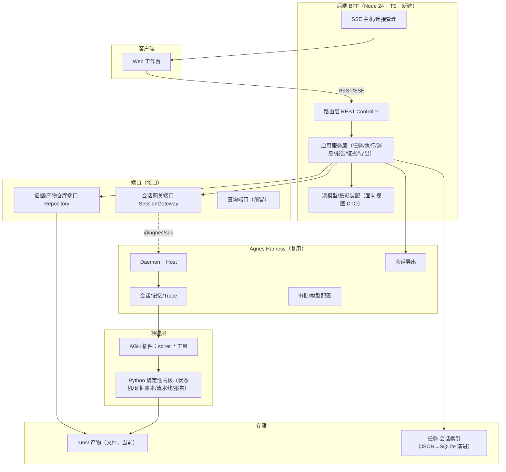
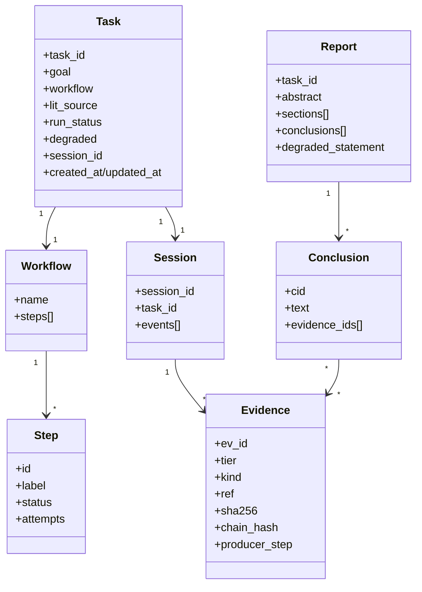

# paper-agent 2.0 后端需求文档（API、领域服务与 AGH 集成）

> 项目：paper-agent ｜ 队伍：你说的都队（U046）
> 文档类型：**后端需求规格说明书（Rebuild 版）**，可直接作为后端/架构开发、测试、运维与排期依据。
> 版本：v2.0-draft ｜ 日期：2026-10-09 ｜ 状态：待评审
> 配套文档：《[前端需求文档.md](./前端需求文档.md)》《[README.md](./README.md)》

---

## 1. 文档信息与范围界定

### 1.1 后端使命

提供一套**以 AGH 为执行底座、不旁路、可审计可复现**的后端：对外向工作台提供版本化的 REST + SSE API 与聚合报告；对内把所有任务执行编排为 **AGH 会话**，天然获得会话记录、轨迹、审批与导出；并以插件 / SPI 方式承载科研领域能力，保证可扩展、可平滑演进。

### 1.2 范围界定（MVP）

| 类别                   | 范围                                                                                                                  |
| -------------------- | ------------------------------------------------------------------------------------------------------------------- |
| **In Scope（做）**      | BFF（REST+SSE）、任务生命周期、经 AGH 会话的执行编排、事件归一与推送、报告聚合、证据只读、导出（报告/审计包/会话轨迹）、追问多轮、降级与容错策略、环境自检与一键启动                         |
| **Out of Scope（不做）** | 多用户/鉴权（仅预留可选 token 开关）、云部署、论文全文批量抓取、用 LLM 自由编排取代确定性状态机、跨 run 数据库查询层（MVP 后）                                          |
| **技术红线**             | ① 领域确定性内核保持**零第三方依赖、可复现**（Python 标准库）；② **执行不得绕过 AGH**（最高优先级架构约束）；③ BFF 技术栈与 AGH 同生态（Node 24 + TypeScript，使用官方 SDK） |

### 1.3 术语

沿用《README.md》附录：AGH、Task/Run、Session、Workflow、Step、Evidence(EV)、Conclusion(C)、Report、Audit Pack、BFF、SPI。

---

## 2. 已知问题与后端处理方案（逐条，必须解决）

> 对应共享问题登记册 P-01 ~ P-07。本章给出**后端根因、处理方案、落点与可复测验收**。

### 2.1 问题 → 后端方案总表

| 编号       | 问题                 | 后端根因                                                                                                                                                             | 后端处理方案                                                                                                                                                                 | 落点服务          |
| -------- | ------------------ | ---------------------------------------------------------------------------------------------------------------------------------------------------------------- | ---------------------------------------------------------------------------------------------------------------------------------------------------------------------- | ------------- |
| **P-01** | 任务总是降级             | ① 4 源中任一不可用（OR 逻辑）即 `degraded=true`，Semantic Scholar 等在无代理网络下常被限流/封锁；② 无连通性预检，区域不可达源仍被默认尝试；③ 重试/超时过于激进，瞬时抖动即降级；④ "用户主动选本地/离线"与"远程失败兜底"都被标记降级；⑤ 故障注入（chaos）可能残留开启 | 见 §2.2 专条                                                                                                                                                              | 执行编排、检索/容错、配置 |
| **P-02** | 前端暴露过多后端内容         | 后端把原始内部对象（系统提示词、工具原始 JSON、哈希）直接作为响应，未提供面向视图的读模型                                                                                                                  | 提供**分层 DTO / 读模型（Projection）**：区分"用户面向字段"与"审计字段"；默认响应不含原始提示词/哈希，审计字段经独立授权接口或显式参数获取                                                                                     | BFF 路由、读模型装配  |
| **P-03** | 输出未形成报告、零散；最终结果未送达 | 缺少统一"报告"聚合根；事件覆盖不全（思考/工具/最终结果未保证发出）；终态未保证产出并送达                                                                                                                   | ① 设立**报告聚合服务**，从各步骤产物装配唯一 Report（结构化 + MD），终态门禁通过才生成；② 补全事件目录并保证终态必发 `done` + 报告可获取；③ 报告原子写、持久化、可重取；④ 未就绪显式状态                                                          | 报告服务、事件总线     |
| **P-04** | AGH 中无记录、无法导出      | **旧版 Web 后端直接 spawn Python、完全绕过 AGH**，任务从未进入 AGH 会话                                                                                                              | ① **所有执行改为经 AGH 会话驱动**（经官方 SDK / 无头会话），禁止 BFF 直接 spawn 领域进程执行主链路；② **一个 Task 持久映射一个 AGH Session（1:1）**并保存 session_id；③ 导出复用 AGH 原生会话导出；④ 验收以 `sessions/export` 可查到记录为准 | 执行编排、会话网关、导出  |
| **P-05** | 底部对话框不起作用          | 未定义/未接线多轮追问接口                                                                                                                                                    | 提供**会话消息接口**：在同一 AGH 会话内多轮发送追问/修订请求；运行中排队、按序执行；返回消息与增量事件                                                                                                               | 消息服务、会话网关     |
| **P-06** | 未真正继承 AGH          | 把 AGH 仅当可选依赖，另造了一套并行工作台与执行通道                                                                                                                                     | 确立**"AGH 即运行时 + 记忆 + 导出底座"**：复用其会话/轨迹/审批/模型配置/导出；领域能力以 AGH 插件工具交付；BFF 只做编排与读模型，不重造底座；提供 AGH 集成一致性校验                                                                    | 架构、会话网关、插件    |
| **P-07** | 启动麻烦、不会启动          | 多终端、多步骤、环境变量契约脆弱、隐性依赖、无自检                                                                                                                                        | ① **单一启动入口**（一条命令 / docker compose）编排 AGH + BFF + 前端，健康等待后开浏览器；② `doctor` 自检（版本/变量/端口/插件信任启用/模型配置/连通性），输出人类可读修复指引；③ 配置文件 + 安全默认值，路径自动探测                                | 启动器、doctor、配置 |

### 2.2 P-01 专条：任务总是降级（详细处理）

**重新定义"降级"语义（核心）**：把旧的单一布尔结果拆为三级。

| 级别                   | 触发条件                                                                | 是否 `degraded=true`   | 对外表现                |
| -------------------- | ------------------------------------------------------------------- | -------------------- | ------------------- |
| **L0 正常**            | 结果覆盖满足策略（达标源数/命中数阈值），即使个别源不可用                                       | 否                    | 中性/绿色               |
| **L1 信息（partial）**   | 个别源不可用，但**覆盖充足**、结果路径未改变                                            | 否（仅记录 source_status） | 灰色"部分源不可用"信息提示      |
| **L2 真降级（degraded）** | 计划路径被**实质性改变**并可能影响结果：全远程失败回落本地语料、跳过步骤、扫描件/OCR 低置信、悬空引用、关键源缺失导致覆盖不足 | **是**                | 橙色横幅"任务未中断" + 原因/影响 |

**配套策略**：

1. **覆盖策略（Coverage Policy，可配置）**：例如"≥2 个源成功且命中数 ≥ N"即判成功；单源状态仅记录、不逐级上报为降级。
2. **连通性预检（Preflight）**：新建任务/执行前探测各源可达性（含代理），不可达源不默认启用；区域感知的默认源集合。
3. **统一重试策略**：瞬时错误（5xx/429/连接/超时）按指数退避 + 抖动重试有限次；4xx 等永久错误不重试；各源独立超时；检索多源**受控并发**（结果按固定顺序归并以保确定性）。
4. **离线不判降级**：用户显式选择 local/offline 是预期路径，`degraded=false`。
5. **故障注入 Fail-closed**：chaos/实验开关默认关闭、不进入正常构建与演示；仅在显式演练命令下生效。
6. **降级可观测**：每次降级记录 步骤/来源/原因/影响/是否可重试，并经事件与报告"降级声明"体现。

**可复测验收**：

- 断网/单源不可用但覆盖充足 → `degraded=false`（仅信息提示）。
- 全远程失败回落本地 / 跳过 / OCR 低置信 → `degraded=true` 且原因可查。
- 主动选 local → `degraded=false`。
- 正常启动（不带 chaos）→ 不出现任何由故障注入导致的降级。

---

## 3. 设计原则与总体架构

### 3.1 设计原则

| 原则                   | 说明                                               |
| -------------------- | ------------------------------------------------ |
| **AGH 不旁路（最高原则）**    | 执行一律经 AGH 会话；BFF 不直接执行主链路（解决 P-04/P-06）          |
| **分层 + 端口适配器**       | 接口层 / 应用层 / 领域层 / 基础设施层；外部依赖（AGH、存储、检索）经端口接入，可替换 |
| **确定性优先**            | 流水线由状态机驱动、产物可复现；模型仅在受控判断点参与，判断全额留痕且不直接充当事实       |
| **报告中心**             | 报告是聚合根与统一交付物；证据与结论为其支撑                           |
| **可审计 / 可溯源**        | 结论强制绑定 fact 证据；账本哈希链；会话轨迹来自 AGH                  |
| **Fail-fast + 人类可读** | 配置/前置不满足立即、明确报错并给修复动作，不产生误导性错误                   |
| **可扩展**              | 工具/数据源/工作流/判断器/导出器均为 SPI/插件；存储与 API 可版本化演进       |

### 3.2 总体架构图



### 3.3 依赖方向（单向，禁止反向）

`工作台 → BFF 接口层 → 应用服务层 → 领域/端口 → AGH 适配器 / 存储适配器`

- 领域层不依赖 BFF/框架；AGH/存储为可替换适配器。
- 横切：配置、日志、鉴权中间件、追踪、健康检查。

---

## 4. 服务划分与领域模型

### 4.1 BFF 服务清单

| 服务                              | 职责                                                           |
| ------------------------------- | ------------------------------------------------------------ |
| **Task Service**                | 创建/列表/详情；维护 Task ↔ Session 映射；工作流与数据源配置校验                    |
| **Execution Orchestrator**      | 经会话网关执行 run-all / step / resume / stop；并发互斥；失败与终态收敛          |
| **Session Gateway（端口+AGH 适配器）** | 用 `@agnes/sdk` 打开/附加 AGH 会话、发送指令与工具序列、订阅会话事件、会话导出；**唯一执行出口** |
| **Event Relay**                 | 会话事件 → 归一事件 → SSE；有序、去重、可补（快照/Last-Event-ID）                 |
| **Report Service**              | 报告聚合（结构化+MD）；运行门禁（哈希链/绑定/判断批次）；原子写与幂等                        |
| **Evidence Read Service**       | 证据/结论/轨迹只读装配；引用回查（cite）                                      |
| **Export Service**              | 报告 MD、审计包 ZIP、AGH 会话轨迹导出；清单与校验                               |
| **Message Service**             | 同会话多轮追问/修订；运行中排队与顺序                                          |
| **Health/Doctor**               | 健康探针与环境自检；人类可读修复指引                                           |
| **Config/Env**                  | 配置加载、密钥管理、环境探测                                               |

### 4.2 核心领域模型



### 4.3 状态机（沿用并固化旧版正确模型）

- **Run 状态**：`PLANNED → RUNNING → DONE | FAILED`（DONE/FAILED 终态）。
- **Step 状态**：`PENDING → RUNNING → DONE | FAILED`；`PENDING → SKIPPED`；`FAILED → RUNNING`（重试/续跑）；DONE/SKIPPED 终态。
- **收敛规则**：全部步骤 DONE/SKIPPED → 自动收敛 DONE；存在 FAILED → 由调用方显式决策（重试或 FAILED）；终态幂等，重复执行不重复登记。
- **终态守卫**：DONE/FAILED 不可逆；终态产物损坏应新建 Task，不回改原 Task。

### 4.4 Task ↔ Session 映射（解决 P-04 的关键）

| 约束         | 说明                                                   |
| ---------- | ---------------------------------------------------- |
| **1:1 映射** | 一个业务 Task 在创建执行时对应并持久保存**唯一 AGH session_id**         |
| **同生命周期**  | step/run-all/resume/message 全部作用于同一 session，不新建并行会话  |
| **可恢复**    | BFF 重启后凭映射重新附加（attach/reattach）会话，续接收事件              |
| **可核对**    | 通过 AGH `sessions` 列表 / `export` 可按 session_id 查到完整记录 |
| **索引存储**   | 映射存任务索引（MVP 用本地 JSON，结构对 SQLite 友好，便于后续替换）           |

---

## 5. 事件模型（SSE）

### 5.1 事件目录

| 事件           | 载荷关键字段                                                               | 时机                     |
| ------------ | -------------------------------------------------------------------- | ---------------------- |
| `ping`       | `ts`                                                                 | 连接建立与心跳                |
| `step`       | `step / status / elapsed_ms? / error?`                               | 步骤 RUNNING/DONE/FAILED |
| `activity`   | `step / human_message / detail? / ts`                                | 过程的人类可读描述（替代直接抛工具细节）   |
| `tool`       | `step / tool / status / input? / output? / sources_status?`          | 工具调用（默认供"过程细节"，可折叠）    |
| `degraded`   | `level(info/degraded) / source / reason / impact / resumable / step` | 部分源不可用 / 真降级           |
| `conclusion` | `cid / text / evidence_ids[]`                                        | 结论产出（按 cid 去重补发）       |
| `message`    | `turn_id / role / delta? / text? / status`                           | 多轮消息/增量文本              |
| `report`     | `task_id / status(ready/generating)`                                 | 报告就绪状态                 |
| `done`       | `run_status / report_ready / error?`                                 | 终态（终态帧必达，随后清理）         |

### 5.2 顺序、幂等与可恢复

- **有序**：事件携带单调序号/时间戳；SSE 保证同连接顺序，客户端按序应用。
- **去重**：step/tool/conclusion/message 以稳定 ID（step/cid/turn_id）幂等合并；终态/终步重复事件安全。
- **可恢复**：
  - 连接建立先发当前快照（直写本连接，不走全局广播），再续接新事件。
  - 支持 `Last-Event-ID` 断线续传；事件缺失时以产物快照兜底重建。
  - **订阅先于补发**（旧版 SSE 竞态缺陷：先补发后入集合导致快照丢失，新版强制先注册连接再补发）。
- **终态保证**：最后一步完成由领域侧自动收敛并必发 `done`；`done` 帧先写 socket 再清理资源。

---

## 6. 容错与降级策略（汇总）

| 机制    | 策略                                                       |
| ----- | -------------------------------------------------------- |
| 重试    | 瞬时错误分类 + 指数退避（如 1s/2s）+ 抖动；上限次数（如 3）；永久错误不重试             |
| 超时    | 单源/单步独立超时；多源受控并发，整体耗时≈最慢源而非各源之和                          |
| 并发    | 检索多源 ThreadPool/并发取数，结果按固定顺序归并（保确定性）；per-Task 执行互斥，防并发双写 |
| 降级    | 采用 §2.2 三级语义；仅 L2 真降级置 `degraded=true` 并写声明              |
| 熔断/兜底 | 全远程失败 → 回落本地语料（标记 L2）；单篇失败隔离跳过；扫描件 OCR 降级并标注置信度          |
| 断点续跑  | 进程崩溃/中断后 resume：已 DONE/SKIPPED 复用，仅跑 PENDING/FAILED      |
| 原子写   | state/report 等关键产物 tmp + `os.replace` 原子落盘，防半截文件被采信      |
| 故障注入  | chaos 默认关闭、Fail-closed，仅演练命令生效                           |

---

## 7. MVP 功能范围与优先级

| 级别             | 含义            |
| -------------- | ------------- |
| **P0（Must）**   | 主线/演示/可信成立所必需 |
| **P1（Should）** | 显著增强健壮与体验     |
| **P2（Could）**  | 可延后           |

### 7.1 后端 MVP 功能清单

| 编号    | 功能                                                        | 优先级 | 对应问题      |
| ----- | --------------------------------------------------------- | --- | --------- |
| BE-01 | BFF 骨架：配置、日志、统一错误模型、参数校验、CORS、API 版本前缀                    | P0  | P-02      |
| BE-02 | 健康检查 `/api/health` 与 doctor 自检（含修复指引）                     | P0  | P-07      |
| BE-03 | 任务创建/列表/详情；Task↔Session 持久映射                              | P0  | P-04      |
| BE-04 | **会话网关（@agnes/sdk）**：打开/附加会话、发送执行指令、订阅事件                  | P0  | P-04、P-06 |
| BE-05 | 经 AGH 的执行：run-all / step / resume / stop；per-Task 互斥与终态收敛 | P0  | P-04、P-06 |
| BE-06 | Event Relay：归一事件、SSE 推送、快照补发、断线可补、终态必达                    | P0  | P-03      |
| BE-07 | 降级三级语义、覆盖策略、统一重试/超时、受控并发、chaos 关闭                         | P0  | P-01      |
| BE-08 | **报告聚合服务**：结构化 + MD、门禁校验、原子写、幂等、可重取                       | P0  | P-03      |
| BE-09 | 证据只读：证据/结论/轨迹装配、cite 引用回查                                 | P0  | P-02、P-06 |
| BE-10 | 导出：报告 MD、审计包 ZIP、AGH 会话轨迹                                 | P0  | P-04      |
| BE-11 | 消息/多轮：同会话追问与修订、运行中排队                                      | P0  | P-05      |
| BE-12 | 面向视图 DTO/读模型（用户字段与审计字段分离）                                 | P0  | P-02      |
| BE-13 | 一键启动器（编排 AGH+BFF+前端、健康等待、开浏览器）                            | P0  | P-07      |
| BE-14 | 自动化测试：服务单元/集成/契约/关键 E2E                                   | P1  | 全部        |
| BE-15 | 可选 token 鉴权开关（默认关）                                        | P2  | —         |

---

## 8. API 规格（MVP）

> 统一前缀 `/api/v1`；仅绑定 `127.0.0.1`；JSON 采用 UTF-8；错误体统一为 `{ "error": string, "code": string }`。

### 8.1 接口总表

| 方法   | 路径                                     | 用途                                       |
| ---- | -------------------------------------- | ---------------------------------------- |
| GET  | `/api/health`                          | 健康探针（版本、根、运行目录、任务数、会话/插件状态）              |
| GET  | `/api/v1/tasks`                        | 任务列表（支持 `?status=`）                      |
| POST | `/api/v1/tasks`                        | 创建任务（goal/workflow/lit_source/sources[]） |
| GET  | `/api/v1/tasks/{id}`                   | 任务快照（面向视图 DTO）                           |
| POST | `/api/v1/tasks/{id}/run-all`           | 经会话跑完整流程                                 |
| POST | `/api/v1/tasks/{id}/step`              | 经会话推进单步（body: `step`）                    |
| POST | `/api/v1/tasks/{id}/resume`            | 断点续跑                                     |
| POST | `/api/v1/tasks/{id}/stop`              | 请求停止（终态以实际为准）                            |
| GET  | `/api/v1/tasks/{id}/events`            | **SSE** 实时事件                             |
| GET  | `/api/v1/tasks/{id}/report`            | 报告（结构化 JSON；MD 见下）                       |
| GET  | `/api/v1/tasks/{id}/report.md`         | 报告 Markdown（`text/markdown`）             |
| GET  | `/api/v1/tasks/{id}/evidence`          | 证据/结论/轨迹只读                               |
| GET  | `/api/v1/tasks/{id}/cite?ev=EV-0001`   | 引用回查（DOI/作者/年份或哈希前缀）                     |
| POST | `/api/v1/tasks/{id}/messages`          | 多轮追问/修订（运行中排队）                           |
| GET  | `/api/v1/tasks/{id}/export?kind=report | audit                                    |

### 8.2 关键契约示例

**创建任务** `POST /api/v1/tasks`

```
Request:
{ "goal": "检索并综述固态电解质界面阻抗的表征方法",
  "workflow": "research",            // 缺省 research
  "lit_source": "auto",              // local | arxiv | auto
  "sources": ["arxiv","crossref","openalex","semantic_scholar"] }

201 Response:
{ "task_id": "run-YYYYMMDD-HHMMSS-xxxxxx",
  "session_id": "<agh session id>",  // 已建立并映射
  "state": { ...TaskSnapshot... },
  "preflight": { "sources": { "arxiv":"ok", "semantic_scholar":"unavailable:429" } } }
```

- 校验：`goal` 必填（去空格非空）、长度上限（如 8192）；workflow/source 非法回退默认并显式告知。
- 错误：400 `BAD_GOAL/BAD_BODY`；500 `SESSION_ERROR`（附可读原因）。

**SSE** `GET /api/v1/tasks/{id}/events`

- 响应头：`Content-Type: text/event-stream`、`Cache-Control: no-cache, no-transform`、`Connection: keep-alive`、`X-Accel-Buffering: no`。
- 建连：`retry: 2000` → 注册订阅 → 直写当前快照（step/tool/conclusion）→ 续接实时事件；30s 心跳 `: ping`。

**报告** `GET /api/v1/tasks/{id}/report`

- 就绪：`200 { status:"ready", report: { title, abstract, sections, conclusions[] } }`
- 未就绪：`200 { status:"generating" }`（不报错）；任务不存在：404。
- 报告 MD：`200 text/markdown`，含结论证据角标与降级声明；安全头 `X-Content-Type-Options: nosniff`、`Content-Disposition: inline`。

**多轮消息** `POST /api/v1/tasks/{id}/messages`

```
Request:  { "text": "请补充近两年的最新进展", "action": "ask" }   // ask | revise
200:      { "queued": false, "turn_id": "...", "status": "running" }
运行中:    200 { "queued": true, "order": 1 }
```

**导出** `GET .../export?kind=...`

- `report` → Markdown 文件流；`audit` → 审计包 ZIP（报告+账本+事件+结论+校验脚本）；`session` → AGH 会话轨迹（经原生导出）。
- 未完成：409 `NOT_READY` 并说明可导出范围。

### 8.3 状态码与错误码（摘要）

| HTTP | code                                       | 场景                         |
| ---- | ------------------------------------------ | -------------------------- |
| 400  | `BAD_GOAL / BAD_BODY / BAD_PARAM`          | 入参非法                       |
| 400  | `BAD_ID`                                   | task/session 标识格式非法（防目录穿越） |
| 404  | `NOT_FOUND / NO_REPORT`                    | 任务或报告不存在                   |
| 409  | `BUSY`                                     | 该任务已有步骤在执行                 |
| 409  | `BAD_STATE / NOT_READY`                    | 当前状态不允许该操作                 |
| 500  | `SESSION_ERROR / CLI_ERROR / EXPORT_ERROR` | 会话/执行/导出失败（附可读原因）          |

> 标识白名单：task_id 仅允许安全字符集（如 `^run-[0-9A-Za-z_-]+$`），拒绝路径分隔符与 `..`，防目录穿越。

---

## 9. 功能详细需求与验收标准（服务级）

### 9.1 任务与会话（BE-03/04，P0）

- 创建任务时经会话网关建立 AGH 会话并持久 1:1 映射。
- **验收**：
  - Given 合法 goal，When POST tasks，Then 201 且返回 task_id 与 session_id，AGH `sessions` 列表可查到该会话。
  - When BFF 重启，Then 凭映射可重新附加会话，历史可读、事件可续。
  - Given 非法/空 goal，When 提交，Then 400 且不产生孤儿任务或会话。

### 9.2 经 AGH 执行（BE-05，P0）

- run-all/step/resume/stop 全部经会话发送；执行互斥；终态自动收敛。
- **验收**：
  - When 触发 run-all，Then 会话中产生完整工具调用序列，任务终态 DONE 且报告就绪。
  - Given 并发双请求，When 同时触发，Then 仅一个执行，另一个 409 `BUSY`。
  - Given 执行中崩溃/中断，When resume，Then 已完成步骤复用、仅跑剩余步骤。
  - **BFF 不直接 spawn 领域进程跑主链路**（代码/测试核查无旁路执行路径）。

### 9.3 事件中继（BE-06，P0）

- **验收**：
  - 新连接先收完整快照再收实时事件，无丢失/重复。
  - 刷新/重连后视图与实时路径数据同形一致。
  - 终态必收 `done`；断线重连可补齐缺失事件。

### 9.4 降级治理（BE-07，P0）

- 验收以 §2.2"可复测验收"为准：覆盖充足不判降级、真降级才置位、主动离线不判降级、无 chaos 残留。

### 9.5 报告聚合（BE-08，P0）

- 报告生成前运行门禁：哈希链完整、结论绑定 fact 证据、判断批次齐全（可配置旁路仅用于调试）。
- **验收**：
  - Given 任务正常完成，When 请求报告，Then 返回完整结构化报告与 MD，结论 100% 绑定有效证据。
  - Given 账本被篡改/绑定缺失，When 生成报告，Then 拒绝并明确原因。
  - 报告为原子写；重复请求幂等；中断后不会把半截报告当有效产物。
  - 报告含"降级声明"（当 degraded=true）。

### 9.6 证据只读与导出（BE-09/10，P0）

- **验收**：
  - cite 可按 EV 回查文献 DOI/作者/年份或产物哈希前缀。
  - 导出三类均可用：报告 MD、审计包 ZIP（含校验脚本）、AGH 会话轨迹；失败给原因与重试。
  - 审计包内文件清单与校验状态完整。

### 9.7 多轮消息（BE-11，P0）

- **验收**：
  - 空闲时追问/修订在同一会话执行并返回增量与结果。
  - 运行中发送进入排队、显示顺序，结束后按序执行；支持"立即发送/删除"。
  - 全程仍在同一 AGH 会话留痕。

---

## 10. 非功能性需求

| 类别  | 要求                                                                          |
| --- | --------------------------------------------------------------------------- |
| 性能  | 单步真实耗时可观测（在线检索约 8–12s）；多源并发后整步≈最慢源；BFF 对热路径产物读取加 mtime 指纹缓存；接口 P95 响应满足交互预期 |
| 可靠  | 重试/降级/崩溃续跑/复现校验失败均有处理；关键产物原子写；内存态崩溃可由磁盘重建                                   |
| 可复现 | 确定性内核 + 冻结快照；实验产物 SHA-256 校验；显式排除"模型跨次选择"等不可承诺项                             |
| 可观测 | 结构化日志（级别/格式统一）、健康探针、会话轨迹；关键事件可追溯                                            |
| 可扩展 | SPI 化（工具/数据源/工作流/判断器/导出器）；存储与事件总线可替换；API 版本化                                |
| 配置  | 配置文件 + 环境变量；路径自动探测；换机零改动；密钥仅环境注入                                            |
| 兼容  | Node ≥ 24、Python ≥ 3.10；主流浏览器经前端对接                                          |

---

## 11. 安全与合规

| 项         | 要求                                                                |
| --------- | ----------------------------------------------------------------- |
| 密钥管理      | 模型 API Key 仅经环境变量/密钥引用注入，**绝不入库、不回显明文**                           |
| 子进程环境     | 以**白名单**裁剪子进程环境（不整包透传宿主 env，防提示注入诱导出站泄露密钥）                        |
| 输入校验      | goal/标识/参数严格校验；标识白名单防目录穿越；拒绝非法路径与超长输入                             |
| 提示注入      | 内置提示注入检测；外部文档/文件名/工具结果视为不可信数据，不执行其中指令                             |
| 网络绑定/CORS | 仅绑 `127.0.0.1`；CORS 白名单按 Origin 回显（不放任 `*`）；SSE 同样受控              |
| 可选鉴权      | `PAPER_AGENT_TOKEN` 设置时对写路由校验令牌，未设置行为不变（默认关）                      |
| 审计防篡改     | 证据 append-only 哈希链；结论强制绑定 fact；篡改即拒绝出报告（检测而非阻止完全控盘者，边界诚实声明）       |
| 数据真实性     | 使用真实 DOI 与许可数据集（如 CC-BY-4.0），标注 as-reported；**严禁伪造数据**；不做论文全文批量抓取 |

---

## 12. 部署、启动与配置（解决 P-07）

### 12.1 一键启动（单一入口）

- 提供**一条命令**（如仓库根 `pnpm dev` / `./start` / `docker compose up`）：
  1. 若 AGH 构建产物缺失 → 自动构建（或给出明确构建提示）；
  2. 启动 AGH daemon（serve）并等待就绪；
  3. 启动 BFF（含会话网关）；
  4. 启动/托管前端（开发服务器或托管静态产物）；
  5. 健康检查通过 → 自动打开浏览器到**唯一 URL**；
  6. 任一步失败 → 打印人类可读原因与修复动作并中止。
- 端口统一规划、占用即报告并支持自动顺延或给出释放指引。

### 12.2 Doctor 环境自检

- 命令（如 `pnpm doctor`）逐项检查并输出 状态/实测值/修复指引：
  Node ≥ 24、Python ≥ 3.10、项目根与内核可导入、运行目录可写、环境变量实际生效值、端口可用、AGH 插件已信任并启用（工具注册数）、模型已配置、数据源连通性（含代理）。
- 支持 `--json`（供启动器消费）、`--quiet`（仅退出码）；退出码：0 全绿 / 2 有可继续告警 / 1 有阻断。
- AGH 未安装时相关项降级为告警而非硬失败（避免 demo-kit 强依赖）。

### 12.3 配置与环境变量（建议）

| 配置                     | 用途                            |
| ---------------------- | ----------------------------- |
| `AGNES_API_KEY` / 模型配置 | 仅环境注入；模型与供应商也可经 AGH 原生设置完成    |
| `PAPER_AGENT_ROOT`     | 项目根（启动器可自动探测；显式校验存在性，失效即明确报错） |
| `PAPER_AGENT_PYTHON`   | Python 解释器（缺省自动探测 PATH）       |
| `PAPER_AGENT_TOKEN`    | 可选写路由令牌（默认关）                  |
| `HTTP(S)_PROXY`        | 在线检索/模型代理（白名单透传）              |
| 工作流/数据源默认值、端口、CORS 覆盖  | 配置文件或环境变量，提供安全默认              |

> 环境变量命名应合法、可在常规 shell 直接导出；避免旧版"带连字符且只能在 daemon 启动瞬间注入"的脆弱契约；命名双轨兼容仅作过渡并标注废弃。

### 12.4 容器化（建议，便于复现）

- 提供 `docker-compose.yml`：AGH 服务 + BFF 服务 + 前端托管；卷挂载运行目录与配置；健康检查与依赖顺序；密钥经环境注入。
- 同时保留"本机源码一键启动"路径，满足比赛现场与演示。

---

## 13. MVP 之后迭代规划

### 13.1 路线图

| 阶段           | 主题                        | 后端主要内容                                                           |
| ------------ | ------------------------- | ---------------------------------------------------------------- |
| **MVP V1.0** | 主线 + 报告中心 + AGH 留痕 + 一键启动 | 见 §7 全部 P0                                                       |
| **V1.1**     | 证据查询层                     | SQLite 索引、按 DOI/关键词/tier/来源过滤、跨 run 聚合、证据图谱（nodes/edges）、查询缓存    |
| **V1.2**     | 集成扩展                      | 更多数据源、MCP 接入、可插拔判断器（Rule/Model）、导出多格式（PDF/DOCX/HTML）、通知与 webhook |
| **V1.3**     | 健壮与治理                     | 可选鉴权完善、批量/定时任务、队列与并发调度、可观测性（指标/追踪）、报告版本与 Diff                    |
| **V2.0**     | 平台化                       | 多用户/权限、云部署、工作流/插件市场、事件总线分布式化、存储升级（DB/对象存储）、协作与审计合规               |

### 13.2 领域方向

| 域      | 演进                                          |
| ------ | ------------------------------------------- |
| 工作流    | WorkflowSpec 参数化：新增工作流仅提供步骤集与 step 实现，零骨架成本 |
| 工具/数据源 | SPI 注册：新工具/新源即插即用，独立超时/重试/鉴权                |
| 判断器    | 可插拔 Judge（规则/模型），反判据对比，判断全额留痕               |
| 存储     | 文件 → SQLite → DB/对象存储；仓库接口不变即可替换            |
| 事件     | 本地 EventEmitter → 进程内总线 → 分布式消息；支持订阅/回放     |
| 编排     | 在不破坏可复现的前提下，受控引入模型规划（规划与执行分离、可审计）           |

---

## 14. 可扩展性设计（SPI 与扩展点）

| 扩展点                | 形态                                                | 新增成本                 |
| ------------------ | ------------------------------------------------- | -------------------- |
| **Tool SPI**       | AGH 插件 `registerTool`；统一 meta（只读/破坏性/并发安全/审批/可重放） | 新增工具=注册一个工具，不改引擎     |
| **Source SPI**     | 数据源接口：build_url/parse/transport/降级；独立超时重试         | 新增检索源=实现一个 Source    |
| **Workflow SPI**   | WorkflowSpec（步骤集 + step_fn 表 + 依赖 + 上下文差异）        | 新增工作流=声明规格，复用状态机     |
| **Judge SPI**      | 判断器接口（Rule/Model），输出 verdict/rationale            | 新增判断器=实现接口           |
| **Exporter SPI**   | 导出器接口（report/audit/session/未来 PDF…）               | 新增导出格式=实现导出器         |
| **Repository SPI** | 任务/证据/映射仓库接口                                      | 文件/SQLite/DB 互换不影响上层 |
| **Event Bus SPI**  | 发布/订阅/回放接口                                        | 本地/分布式可替换            |
| **API 版本化**        | `/api/v1` 前缀 + 兼容性约定                              | 平滑升级、旧客户端不破坏         |

---

## 15. 测试与验收策略

| 层级     | 内容                                                          |
| ------ | ----------------------------------------------------------- |
| 单元测试   | 状态机、降级判定、覆盖策略、重试/退避、报告装配、DTO 映射、标识校验                        |
| 集成测试   | 会话网关 ↔ AGH（可用本地/仿真会话）、仓库读写、事件中继与 SSE                        |
| 契约测试   | API 请求/响应与 OpenAPI/共享类型一致；前后端 DTO 不漂移                       |
| E2E    | 主旅程：新建 →（经 AGH）运行 → 报告 → 证据 → 导出 → 追问；故障用例（重试/降级/崩溃续跑/复现失败） |
| 演示回归   | Mock 离线模式主旅程自动化；关键页面无 JS 报错                                 |
| CI 质量门 | 类型检查 + Lint + 构建 + 测试；关键路径必测；测试默认离线、不依赖真实密钥                 |

> 旧版"server 零单测"为明确缺口，新版要求 BFF 纯逻辑（互斥/缓存/校验/状态收敛）具备可测的单元/集成网，作为后续重构前提。

---

## 16. 后端验收总清单（DoD）

- [ ] §7 所有 **P0 功能**实现并通过 §9 验收。
- [ ] **P-01 ~ P-07 可复测且通过**，重点：
  - 任务不再"无差别降级"（§2.2 三级语义生效）。
  - **每个任务在 AGH 中有 1:1 会话记录、可导出**（sessions/export 可查）。
  - BFF **无绕过 AGH 的主链路执行**。
  - 每次完成生成**一份完整报告**，结论证据绑定 100%。
  - 底部追问多轮可用；无"假控件"。
  - **一条命令启动**，doctor 可自检并给修复指引。
- [ ] 面向视图 DTO 生效，默认响应不泄露原始提示词/哈希（审计字段独立受控）。
- [ ] SSE 快照/顺序/去重/终态正确，刷新与实时一致。
- [ ] 安全合规：密钥不入库、环境白名单、输入校验、CORS、数据真实。
- [ ] 通过类型/Lint/构建，关键路径自动化测试在 CI 通过。

---

## 附录 A：状态枚举（权威）

| 枚举             | 取值                                                                         |
| -------------- | -------------------------------------------------------------------------- |
| RunStatus      | `PLANNED / RUNNING / DONE / FAILED`                                        |
| StepStatus     | `PENDING / RUNNING / DONE / FAILED / SKIPPED`                              |
| Evidence.tier  | `fact / artifact`（注意：可进结论的为 fact）                                          |
| Evidence.kind  | `literature / data / analysis / note / factcheck / draft / review`（及实验类扩展） |
| Degraded.level | `info / degraded`                                                          |

## 附录 B：事件与错误码索引

- 事件：`ping / step / activity / tool / degraded / conclusion / message / report / done`（见 §5.1）。
- 错误码：`BAD_GOAL / BAD_BODY / BAD_PARAM / BAD_ID / NOT_FOUND / NO_REPORT / BUSY / BAD_STATE / NOT_READY / SESSION_ERROR / CLI_ERROR / EXPORT_ERROR`（见 §8.3）。

## 附录 C：修订记录

| 版本         | 日期         | 说明          | 作者  |
| ---------- | ---------- | ----------- | --- |
| v2.0-draft | 2026-10-09 | 推翻重做版后端需求首稿 | 团队  |
